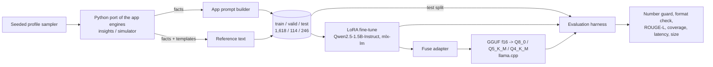

# finsight-insight-llm

**Fine-tuned a 1.5B open model to write FinSight's spending insights from the app's own facts. Against the base model and a 2-shot prompt-only baseline, on a held-out test set, the fine-tuned model follows the output format on 100% of prompts (base zero-shot: 58.9%) and raises reference overlap from ROUGE-L 0.252 (base) and 0.373 (2-shot) to 0.454. Quantized to GGUF, the `Q5_K_M` file is 1.1 GB and decodes at about 71 tokens/s on an M2 Pro with no loss in number fidelity or format validity; fact coverage is 0.894 vs 0.920 for the f16 GGUF.**

FinSight is a personal-finance Android app. Its deterministic engines compute every number and a default wording; a model is only allowed to *re-phrase* those facts, and any output containing a money figure that is not in the facts is thrown away (the "number guard"). This project trains a small model for that job and measures it the way the product would judge it.

> Everything in this README comes from real runs in `results/`. The raw per-example outputs, scores and the exact command for every row are in `results/raw/*.jsonl`.

## Results

Held-out test split: 246 examples (117 insight, 78 simulation, 51 goal) that the model never saw in training. Greedy decoding. Measured on a Mac mini (M2 Pro, 32 GB) with the machine otherwise idle.

| Model | Number fidelity | Format valid | ROUGE-L | Fact coverage | Decode tok/s | Mean latency | Size on disk |
|---|---|---|---|---|---|---|---|
| Base, zero-shot (MLX bf16) | 97.6% | 58.9% | 0.252 | 0.631 | 47.9 | 1.91 s | 3,099 MB |
| Base + 2-shot prompt (MLX bf16) | 100.0% | 95.1% | 0.373 | 0.894 | 39.3 | 1.94 s | 3,099 MB |
| **Fine-tuned (LoRA), zero-shot (MLX bf16)** | 100.0% | 100.0% | 0.454 | 0.881 | 30.5 | 2.17 s | 3,099 MB + 74 MB adapter |
| Fine-tuned, GGUF f16 | 100.0% | 100.0% | 0.448 | 0.920 | 47.1 | 1.45 s | 3,094 MB |
| Fine-tuned, GGUF Q8_0 | 100.0% | 100.0% | 0.447 | 0.913 | 71.8 | 0.95 s | 1,647 MB |
| **Fine-tuned, GGUF Q5_K_M** (winner) | 100.0% | 100.0% | 0.456 | 0.894 | 70.9 | 0.92 s | 1,125 MB |
| Fine-tuned, GGUF Q4_K_M | 100.0% | 98.0% | 0.458 | 0.846 | 83.5 | 0.76 s | 986 MB |

Metric definitions:

- **Number fidelity**: share of outputs where every money figure appears in the facts (a port of the app's `NumberGuard`, tolerance ₱0.51). Higher is better; this is the property the product enforces.
- **Format valid**: the raw output follows the contract the app asks for: `insight` is exactly two lines `INSIGHT:` (at most two sentences) and `ACTION:` (one sentence); `simulation` is two to three sentences; `goal` is one sentence of at most 30 words; no markdown or reasoning blocks.
- **ROUGE-L**: word-level ROUGE-L F1 against the reference text (lowercased words and whole money figures; punctuation is not part of a token). See the caveat below.
- **Fact coverage**: share of the reference's money figures that the output also states (does it actually use the numbers it was given).
- **Decode tok/s, latency**: mean over the 246 test prompts, from the runtime that produced the row. MLX rows use `mlx-lm`; GGUF rows use `llama-server` (llama.cpp, Metal, all layers offloaded) over local HTTP, so the two groups are different runtimes and not a pure quantization comparison. The fine-tuned MLX row is slower than the base because the adapter is applied unfused at run time; fusing it (the GGUF rows) removes that cost.

Per-task tables (number fidelity, format validity, ROUGE-L) are in [`results/RESULTS.md`](results/RESULTS.md).

### What the numbers say

- **Fine-tuning fixes format and style, not just numbers.** Zero-shot, the base model follows the contract on only 58.9% of prompts (48.7% for insights, 37.3% for goals). Two worked examples in the prompt bring that to 95.1% at the price of a longer prompt; the fine-tuned model reaches 100% with the short, production prompt.
- **Number fidelity was already high for this task** because the facts contain every figure the model needs: the base model failed the guard on 2.4% of outputs (6 of 246: 5 simulation, 1 insight), e.g. a simulation answer that derived a daily saving of ₱17.27 that is not in the facts. With either a few-shot prompt or fine-tuning it was 100%. The guard remains the safety net; fine-tuning removes the need to fall back to the deterministic text.
- **Fine-tuning buys quality over the prompt-only baseline**: ROUGE-L 0.454 vs 0.373 (few-shot) and 0.252 (base); the gap is largest for insights (0.517 vs 0.433) and goals (0.513 vs 0.331).
- **Quantization costs little here, but not nothing.** Q8_0 and Q5_K_M match the f16 GGUF on format and fidelity, with ROUGE-L within 0.009; fact coverage drops from 0.920 (f16) to 0.913 (Q8_0) and 0.894 (Q5_K_M). Q4_K_M is the smallest (986 MB) and fastest (83.5 tok/s) but is the only quant that breaks the format contract (98.0% valid; 95.7% on insights) and has the lowest fact coverage (0.846), so Q5_K_M is the pick.

**Winner: fine-tuned model, GGUF `Q5_K_M`** (1,125 MB, 70.9 tok/s, 0.92 s mean latency, 100% fidelity and format). Q8_0 adds 0.019 fact coverage (0.913 vs 0.894) for 46% more bytes, and no gain on fidelity or format.

### Caveats on these numbers

- **The references are templated**, not human-written (see [`DATASET_CARD.md`](DATASET_CARD.md)). A fine-tuned model imitating those phrasings scores high ROUGE-L by construction, and the base/few-shot models are penalized for a perfectly reasonable different wording. ROUGE-L therefore measures "closeness to this house style", not absolute quality. No LLM-as-judge was run: no judge model beyond the one under test was available offline, and judging with the model under test would be circular.
- **One run, one seed, one test set of 246.** Differences of a few ROUGE-L points between quantizations (e.g. 0.447 vs 0.458) are within noise; I did not compute confidence intervals.
- **The test set comes from the same synthetic generator as the training data.** It shows that the model learned the task and the format, not that it generalizes to real user data or to facts the generator cannot produce.
- Speeds are for this machine, with one request at a time.

## Preference tuning (DPO) on top of the SFT model

Question: does preference tuning add anything on top of the SFT adapter? Method: build preference pairs from the training facts only, run DPO on the SFT LoRA weights, and compare SFT vs SFT+DPO on the same 246-row held-out test set plus a stress set of adversarial facts. **Result: it did not help.** Number fidelity and format validity were already 100% for SFT, so there was no headroom; ROUGE-L is unchanged within noise and fact coverage got slightly worse.

### Preference data (fully synthetic)

Built by `src/finsight_llm/preferences.py` from `data/train.jsonl` (the test split is never read). `chosen` is the reference insight. `rejected` is one of:

| Rejected type | How it is made | What catches it |
|---|---|---|
| `changed_figure` | one money figure replaced by a near-duplicate (digit transposition, +/-10%, etc.) that is not in the facts | number guard |
| `invented_figure` | an extra clause with a plausible but ungiven figure (annualised, scaled) | number guard |
| `broken_format` | missing `ACTION:` line, markdown, preamble, extra line, too many/few sentences, goal over 30 words | format checker |
| `vague_text` / `off_topic_text` | in-format but generic or off-topic text with unsupported claims | fact coverage |
| `misattributed_figure` | a figure swapped for a different figure from the facts (grounded but wrong) | fact coverage |
| `sft_sample` | worst of 4 samples of the SFT model (temperature 1.0, top-p 0.95) that loses to the reference: fails the guard/format, covers fewer reference figures, or has ROUGE-L < 0.8 | existing metrics |

Every synthetic rejection is re-scored and kept only if it really fails (`is_failure`); up to two distinct synthetic types per prompt. Counts (`data/preferences/stats.json`): 4,217 train pairs and 469 valid pairs (1,456 / 162 prompts, split by prompt id, 10% valid), of which 2,775 + 309 synthetic and 1,442 + 160 sampled. Sampled negatives are mostly paraphrases: of the 1,602, none fails the guard or the format checker (SFT is already clean), 593 state fewer of the reference's figures, and the rest are only less close to the reference text. Mined samples are in `data/preferences/sft_samples.jsonl`.

### Training

mlx-lm 0.32 has no DPO trainer, so `src/finsight_llm/dpo.py` implements the DPO loss in MLX: the policy is base + the SFT adapter (only the 18.5M LoRA parameters train), the reference is the same model before any update (its sequence log-probs are computed once, so no second model copy). Dropout is off, so the step-0 loss is exactly ln 2 (logged as a check).

| | |
|---|---|
| beta / lr / schedule | 0.1 / 1e-5 / 30-step warmup, cosine to 1e-6, AdamW, grad-clip 1.0 |
| Steps | 900 steps x 2 pairs (1,800 train pairs, a seeded subset of the 4,217), gradient checkpointing |
| Validation loss (469 pairs) | 0.693 (0) -> 0.691 (100) -> 0.669 (200) -> 0.649 (300) -> **0.625 (400)** -> 0.638 -> 0.653 -> 0.668 -> 0.680 -> 0.686 (900) |
| Validation pair accuracy | 0.495 at 100, 0.627 at 400, 0.557 at 900 |
| Time | 6,324 s optimisation + 1,337 s for the reference log-probs; 7,989 s wall-clock |
| Peak memory | 11.2 GB MLX peak; 28.3 GB process peak footprint (`/usr/bin/time -l`, includes cached buffers) |
| Adapter | 74 MB (same shape as the SFT adapter) |

Validation loss is lowest at step 400 and rises afterwards (the policy overfits the 1,800-pair subset). **The step-400 checkpoint is the one evaluated below**, chosen by validation loss on held-out *train-split* pairs before looking at any test number; the final step-900 adapter scores the same on the test set (ROUGE-L 0.459, fact coverage 0.847, `results/dpo/raw/dpo-it900.jsonl`). Logs: [`results/dpo/train.log`](results/dpo/train.log), stats: [`results/dpo/dpo_stats.json`](results/dpo/dpo_stats.json).

What went wrong on the way: a first run (batch 4 pairs, lr 5e-6, no checkpointing) did not diverge but was slow (11-13 s/step, 24.7 GB peak) and died at about step 260 with the OS GPU watchdog error ([`results/dpo/train_attempt1_batch4_crashed.log`](results/dpo/train_attempt1_batch4_crashed.log)). It had also learned slowly, so I restarted with batch 2, gradient checkpointing and lr 1e-5 (a choice made after seeing that run).

### Results (SFT vs SFT+DPO, greedy, same scoring code)

Test split, n = 246. Intervals are 2,000-resample paired bootstraps.

| | SFT | SFT + DPO | Delta | 95% CI |
|---|---|---|---|---|
| Number fidelity | 100.0% | 100.0% | 0 | |
| Format valid | 100.0% | 100.0% | 0 | |
| ROUGE-L | 0.454 | 0.458 | +0.003 | [-0.028, +0.037] |
| Fact coverage | 0.881 | 0.847 | -0.035 | [-0.058, -0.011] |

Stress set, n = 234 (`data/stress.jsonl`, `src/finsight_llm/stress.py`): ordinary facts plus 8 near-duplicate decoy figures per prompt (transposed digits, off-by-a-little amounts), none in the reference. A decoy in the output passes the guard but is the wrong number.

| | SFT | SFT + DPO | Delta | 95% CI |
|---|---|---|---|---|
| Number fidelity | 100.0% | 100.0% | 0 | |
| Format valid | 100.0% | 100.0% | 0 | |
| ROUGE-L | 0.464 | 0.435 | -0.029 | [-0.064, +0.006] |
| Fact coverage | 0.842 | 0.788 | -0.054 | [-0.083, -0.024] |
| Decoy rate (lower is better) | 0.9% | 1.7% | +0.9 pp | |

The drop is concentrated in simulations (fact coverage 0.919 -> 0.774 on test, 0.957 -> 0.760 on stress), where the tuned model more often leaves out one of the projected figures; goals improved slightly (0.650 -> 0.706 test). SFT was not weak on the stress set: it held 100% fidelity and 100% format, and copied a decoy on only 0.9% of prompts. Per-task tables: [`results/dpo/RESULTS.md`](results/dpo/RESULTS.md).

GGUF `Q5_K_M` of the DPO model (same export and `llama-server` benchmark as above, test split):

| Model | Number fidelity | Format valid | ROUGE-L | Fact coverage | Decode tok/s | Mean latency | Size |
|---|---|---|---|---|---|---|---|
| SFT, Q5_K_M | 100.0% | 100.0% | 0.456 | 0.894 | 70.9 | 0.92 s | 1,125 MB |
| SFT + DPO, Q5_K_M | 100.0% | 100.0% | 0.453 | 0.867 | 71.5 | 0.88 s | 1,125 MB |

**Verdict:** on this task DPO is a null-to-slightly-negative result: SFT already saturates the guard and format checks, the sampled negatives are mostly paraphrases, and the tuned model trades a little fact coverage for nothing measurable, so the SFT model remains the one to ship.

Caveats: one seed, one run; pairs come from the same templated generator as the data; the DPO optimiser saw 1,800 of the 4,217 pairs; the SFT test row is the committed run from the table above (greedy decoding, so deterministic) and speeds are from different sessions; the stress set is adversarial by construction, not real traffic.

Reproduce: `scripts/dpo.sh pairs|train|eval|export` (or `all`); `ITERS`, `LR`, `BETA` env vars set the hyperparameters; `LLAMA_CPP_SRC` is needed for `export`. Adapters and GGUF files are git-ignored.

## Architecture



Runtime contract (mirrors the app): the model receives the facts block plus the app's instruction; its output is cleaned, parsed and checked by the number guard; on failure the app keeps its deterministic wording.

## Key decisions

- **Base model: Qwen2.5-1.5B-Instruct.** About 1.5B parameters (the requested 1-3B range), supported by both `mlx-lm` and llama.cpp, a chat template that the GGUF converter understands, **Apache-2.0** (free redistribution, including fine-tuned derivatives; I avoided the 3B sibling because it ships under a different, more restrictive license), and downloadable anonymously (no gated access). A 1B/3B Llama would have required accepting a license and logging in to download; I avoided it. The 1.5B size also fits the target: it runs at 70+ tok/s quantized on a laptop-class GPU.
- **Synthetic facts through a port of the real engines**, so the input distribution (wording, arithmetic, thresholds) matches the app. Splits are by profile, no input appears twice, and every reference is checked by the guard at generation time.
- **LoRA on all linear layers, bf16 base.** Rank 16 over attention and MLP projections of all 28 blocks (18.5M trainable parameters, 1.2%). Full bf16 fits comfortably in 32 GB, so 4-bit QLoRA was not needed and would have added a quantization error before the quantization we actually want to measure.
- **Loss on the reply only** (`mask_prompt`), so the model is not trained to reproduce the facts.
- **Greedy decoding for evaluation** for reproducibility (the app samples at temperature 0.4).
- **Prompt-only baseline = 2-shot** with two fixed training examples per task, chosen deterministically (first examples of fixed kinds), not tuned.
- **Quantizations: Q8_0, Q5_K_M, Q4_K_M** plus the f16 reference, all evaluated on the same test set through the same server.

### Training

| | |
|---|---|
| Base | Qwen2.5-1.5B-Instruct (bf16) |
| Method | LoRA, rank 16, scale 20, dropout 0.05, all attention + MLP projections, 28 layers |
| Trainable parameters | 18.465M of 1,543.7M (1.196%) |
| Optimizer / schedule | AdamW, lr 2e-5, 30-step linear warmup then cosine decay to 2e-6 |
| Batch / steps | batch 4, 600 iterations (about 1.5 epochs of 1,618 examples), max sequence length 768 |
| Validation loss | 1.939 (step 1) -> 0.077 (100) -> 0.048 (200) -> 0.037 (300) -> 0.035 (400, 500) -> 0.034 (600) |
| Wall-clock time | 1,790 s (29.8 min) including 7 full validation passes (about 33 s each) |
| Peak memory | 14.55 GB process peak memory footprint (unified memory, from `/usr/bin/time -l`) |
| Adapter size | 74 MB |
| Hardware | Mac mini, Apple M2 Pro, 32 GB |

Full log: [`results/train.log`](results/train.log). Config: [`configs/lora.yaml`](configs/lora.yaml).

**What went wrong on the way (and was fixed):**

1. A first run at lr 1e-4 diverged (train loss 0.94 at step 20, then 4.5-5.0). I stopped it, kept the log ([`results/train_attempt1_lr1e-4_diverged.log`](results/train_attempt1_lr1e-4_diverged.log)) and restarted at 2e-5 with warmup and cosine decay.
2. A first complete pass (train, export, eval) exposed a flaw in my own dataset: some goal references had two sentences while the app's goal prompt asks for one, so the fine-tuned model was marked invalid for copying them. I fixed the templates, added a test that every reference satisfies the format contract, regenerated the data and re-ran everything. All numbers above are from the corrected data; the earlier results were discarded.
3. Several re-runs were interrupted by the OS GPU watchdog ("Impacting Interactivity") while a screen-sharing session was active; they were repeated unchanged once the display was idle.

## Reproduce

Requires Apple silicon, Python 3.12, Homebrew `llama.cpp`, and a clone of the llama.cpp source at the matching tag for `convert_hf_to_gguf.py`.

```bash
make setup                                   # venv + dependencies
.venv/bin/python -c "from huggingface_hub import snapshot_download as d; \
  d('Qwen/Qwen2.5-1.5B-Instruct', local_dir='models/Qwen2.5-1.5B-Instruct')"   # public, anonymous
make data test                               # regenerate data/ (identical to the committed files) and run tests
make train                                   # LoRA fine-tune (about 30 min on an M2 Pro)
LLAMA_CPP_SRC=/path/to/llama.cpp make export # fuse + GGUF f16 + Q8_0/Q5_K_M/Q4_K_M
make eval                                    # base, few-shot, fine-tuned, every GGUF -> results/RESULTS.md
PYTHONPATH=src python -m finsight_llm.rescore # optional: re-score stored outputs without re-running models
```

Run `make eval` on an otherwise idle machine; latency and tokens/s are part of the output. Raw outputs are written to `results/raw/<name>.jsonl` (first line is metadata with the command), summaries to `results/raw/<name>.summary.json`.

Layout:

```
src/finsight_llm/   engine.py (ported engines) · guard.py (number guard, cleaner, parser) · prompts.py
                    dataset.py · templates.py · metrics.py · backends.py · evaluate.py · report.py
                    money.py · rescore.py
tests/              generator determinism, grounding, splits, engine arithmetic, guard behaviour
data/               train / valid / test .jsonl, stats.json; preferences/ (DPO pairs), stress.jsonl
configs/lora.yaml   training hyperparameters
scripts/            train.sh · export.sh · eval.sh · dpo.sh
                    preferences.py · sample_sft.py · dpo.py · stress.py · dpo_report.py (preference tuning)
results/            RESULTS.md, results.json, train.log, raw/*.jsonl; dpo/ (preference-tuning results)
MODEL_CARD.md       draft model card        DATASET_CARD.md   draft dataset card
```

Model weights, adapters and GGUF files are not committed (they are git-ignored). Sizes are recorded above.

## Limitations

- Synthetic data only; one currency (PHP), seven categories, the app's fixed rules. Not evaluated on real user data.
- Templated references limit what reference-based metrics can say (see caveats). No human or LLM-judge evaluation of tone or helpfulness was done.
- The model rewrites facts; it does not do financial reasoning and must not be used as financial advice. The number guard is still required in production: 100% fidelity on 246 synthetic prompts is not a guarantee.
- Single seed and single run; no confidence intervals.
- Latency comparison across MLX and llama.cpp mixes runtimes. No on-phone (Android) measurement was made; "on-device" here means local Apple-silicon inference with the same GGUF format and runtime family the app uses.
- Fine-tuned goal and simulation outputs are close to the training phrasings; diversity is low by design.

## License

Code, templates and data: Apache-2.0 (see `LICENSE`). The base model Qwen2.5-1.5B-Instruct is Apache-2.0; derivatives keep its notice.
